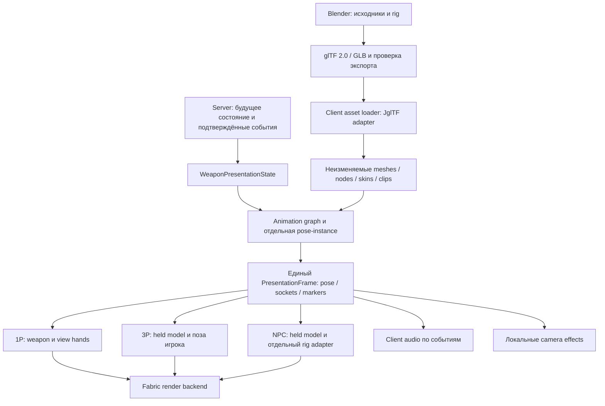

# Bobin Craft — задача №1: аудит и проект новой оружейной системы

Дата: 29 октября 2026. Цель: Minecraft 1.20.1, Fabric, Java 17.
Статус: проект архитектуры для согласования; реализации и новых игровых ассетов нет.

## 1. Область работы и достоверность

Проанализирован загруженный `BOBIN_CRAFT.zip`, каталог `Bobin_craft`, версия из `gradle.properties` — `2.7.7-clean`. Архив распакован отдельно от пустого GitHub-checkout `/workspace/Bobin`. Изменения в GitHub не отправлялись; содержимое архива туда не переносилось.

Выполнена инвентаризация всех файлов Java и ресурсов, импортов, регистраций, mixin-конфигурации, оружейных упоминаний и связей с существующими подсистемами. Ключевые точки инициализации, рендера, камеры, рук, NPC, баллистики и референса изучены непосредственно. Это статический архитектурный аудит, а не доказательство правильности каждой игровой ветви всех 50 586 строк Java.

Отдельно изучен `TaCZ_references_for_BobinCraft.zip`: 27 файлов, выборочные исходники и примеры. `READ_FIRST_RU.md` и `PROMPT_01_FOR_GEMINI_RU.md` рассматриваются как документы внутри вложения, а не новые поручения пользователя. Их указания запускать очистку, ограничиваться одной папкой или приступать к реализации не выполнялись. Приоритет имеет запрос в чате: анализ всего проекта и проектирование без реализации.

**Что проверено сейчас:** структура, статические связи и поиски по всему проекту; синтаксический разбор всех 1516 JSON ресурсов; поиск старых идентификаторов в текстовых файлах и распакованных данных 19 NBT; upstream-документация и отдельные опубликованные артефакты библиотек.

**Что не проверено:** сборка на Java 17, Minecraft client/server, визуальная корректность, производительность, совместимость с Iris/Sodium. Сборка и игровые тесты не запускались. Доступная системная Java — 21; это не проверка целевой Java 17. Исторические отчёты `docs/` и `logs/` не являются результатами проверки текущего архива.

Исходные файлы не изменялись. Сопроводительные отчёты находятся вне проекта. Для воспроизводимого просмотра приложены:

- [CLASS_INVENTORY.json](CLASS_INVENTORY.json) — все 308 production Java-файлов: пакет, импорты, число строк, наличие client-import и SHA-256. Это лексическая инвентаризация, не разрешённый компилятором граф вызовов.
- [RESOURCE_INVENTORY.csv](RESOURCE_INVENTORY.csv) — все 1847 ресурсов, размеры и SHA-256.
- [AK47_TEXT_REFERENCES.txt](AK47_TEXT_REFERENCES.txt) — полный список 22 текстовых совпадений АК-47 в основном проекте.
- [SOURCE_SHA256.json](SOURCE_SHA256.json) — контрольные суммы всех 2381 файла основного архива.

## 2. Текущее устройство проекта

### Сборка и зависимости

| Компонент | Зафиксировано в проекте |
|---|---|
| Minecraft | 1.20.1 |
| Java target/toolchain | 17; `options.release = 17` |
| Fabric Loader | 0.15.11 |
| Fabric API | 0.92.2+1.20.1 |
| Yarn | 1.20.1+build.10 |
| Fabric Loom | 1.7.4 |
| Gradle wrapper | 8.8, задан SHA-256 дистрибутива |
| JUnit Jupiter | 5.10.3 |

Проект однопроектный, `maven-publish` подключён. Client и common-код находятся вместе в `src/main/java`, разделённого `src/client/java` нет. Загрузка идёт через `BobinCraft` и `BobinCraftClient`; GameTest entrypoint — `DestructionGameTestSuite`. Внешних glTF/GLB-, GeckoLib-, PlayerAnimator-, Assimp- или Forge-импортов в production Java нет. Gson/JOML/LWJGL и другие игровые библиотеки уже используются из окружения Minecraft; новые копии этих библиотек без необходимости добавлять нельзя.

### Карта Java

Числа включают подпакеты; 13 test Java-файлов учтены отдельно.

| Подсистема `com.bobincraft` | Файлов | Назначение и граница новой системы |
|---|---:|---|
| Корень | 2 | Общая и клиентская регистрация |
| `block` | 1 | IcicleBlock |
| `camera` | 1 | Коллизия камеры с бронетехникой |
| `combat` | 36 | Урон, ранения, конечности, эффекты, следы попаданий; не переделывать |
| `destruction` | 45 | Структурные разрушения, промышленный дым, debris, синхронизация, GameTest; не переделывать |
| `drone` | 39 | Полёт, управление, видеопоток, чанки, взрывы, рендер и звук; не переделывать |
| `mixin` | 27 | 10 common и 17 client-записей в конфигурации, включая accessor |
| `raid` | 49 | Хаб, рейды, охранники, AI, снабжение, карта, модели NPC; не переделывать |
| `vehicle` | 21 | Бронетехника, снаряды, гранаты, камера и позы; не переделывать |
| `warzone` | 70 | Генерация, поселения, блоки, кабели, окружение и их рендер; не переделывать |
| `weapon` | 17 | 2 общих класса баллистики, 11 GROM-7, 4 RPG; это действующие системы |

### Ресурсы

1847 файлов: 1516 JSON, 280 PNG, 32 OGG, 19 NBT. В частности: 774 JSON моделей, 332 blockstates, 325 block loot tables, 13 рецептов, 3 локализации, 42 записи `sounds.json`. Есть отдельные данные генерации, разрушений и геометрии техники. `.blend`, `.gltf`, `.glb` в проекте отсутствуют.

Модели предметов преимущественно vanilla JSON. Например, `rpg_launcher.json` использует `minecraft:item/handheld`, а `RpgProjectileRenderer` — Java `ModelPart`. `DroneRenderer` строит ModelPart-геометрию; бронетехника и окружение используют также собственные меши/VertexConsumer. `WarzoneGuardModel` — `BipedEntityModel` с собственной геометрией и обработкой ранений; `WarzoneGuardRenderer` добавляет `HeldItemFeatureRenderer` и wound-feature. Собственного универсального полигонального glTF-рендерера нет.

`destruction/client/DestructionKeyframeAnimator` читает свои cube/bone JSON и имеет отдельную семантику разрушений. Наличие этих JSON не означает установленный GeckoLib или универсальный skeleton runtime. Переносить оружие в этот класс либо расширять его ради оружия не следует.

## 3. Аудит старой системы АК-47

### Что отсутствует

В `src/main/java`, `src/test/java` и `src/main/resources` нет совпадений `ak47`/`ak_47`/`ak-47`/`АК-47`/`kalash`/«калаш». Нет соответствующих зарегистрированных предметов, классов, mixin, моделей, анимаций, звуковых записей, текстур, рецептов или локализаций. Не обнаружены старые каталоги `weapon/ak47`, `weapons/ak47`, `art/ak47`, `tools/ak47`, прежние отчёты B2/B2.1. Поиск идентификаторов в 19 NBT также не выявил АК-47. Это вывод по доступному архиву; неизвестные старые ассеты без характерного имени по одному поиску доказать невозможно.

В архиве TaCZ находятся **чужие справочные** `ak47.animation.json`, `ak47_state_machine.lua`, `ak47_display.json`. Они не являются остатками Bobin Craft и не должны попадать в его resources.

### Что действительно осталось

| Файл/группа | Состояние | Решение |
|---|---|---|
| `REMOVE_OLD_AK47_ONCE.bat` | Удаляет прежние пути коду/ассетам/документации АК | Не запускался. В будущем убрать из активного рабочего процесса или архивировать отдельно после согласования |
| `remove_stale_files.bat` | Старые команды удаления АК и других удалённых оружейных классов | Не запускался. Не переносить в инструкции новой системы |
| `README.md:1`, `WEAPON_RESET_README_RU.md` | Сообщают об удалении АК, содержат старые инструкции очистки | Историческая документация, не реализация. Позднее обновить ссылки на новую документацию |
| `build.gradle`, `retiredFiles` и `sourceSets` | Удаление/исключение старых `BobinWeaponHandler`, `GunItem`, `GunServer`, `GunType`, `SniperRifleItem`, `WeaponStats`, старых моделей/рецептов/тестов | Эти файлы отсутствуют. Не воссоздавать и не использовать имена/пути новой системы, совпадающие со списком |

Важная особенность: `build.gradle` вызывает `f.delete()` **во время конфигурации Gradle**, а не только при `clean`. Поэтому даже невинная задача Gradle может удалить файлы с перечисленными путями, если их вернуть. Это причина предусмотреть отдельный, согласованный пересмотр оружейной части cleanup-логики; удалять все retired-правила нельзя, поскольку часть относится к другим системам.

### Что нельзя считать мусором

- `weapon/ShotServer.java` вызывается из `raid/guard/NpcWeaponAdapter.java`; `weapon/heavy/RpgProjectileEntity.java` использует `recordRegionalInjury`. Удаление сломает NPC/RPG и травмы.
- `weapon/BulletPenetration.java` используется NPC, `NpcWeapon` и `ShotServer`. Калибр `RIFLE_762` — не доказательство существования старой реализации АК.
- `NpcWeapon.STANDARD` — активный серверный профиль; `NpcWeapon.item()` возвращает vanilla `Items.CROSSBOW`. `NpcFireControl` хранит магазин/резерв/таймеры в server ticks. Это существующая система NPC, не фундамент нового оружия игрока.
- `NpcWeapon.fromName()` переводит неизвестные исторические имена в `STANDARD`; не удалять совместимость сохранений.
- `weapon/heavy/*` и `weapon/grom7/*` зарегистрированы в entrypoints и действуют независимо.
- `weapon_rack`, `sniper_weapon_rack`, `smg_weapon_rack` — зарегистрированные блоки декора хаба, используемые `HubBuilder`, с моделями, loot и локализациями.
- `gunmetal_hd.png`, `gun_stock_hd.png`, `gun_polymer_hd.png` используются моделями стоек, шкафов и светильников. `weapon_cloud_soft.png` используется гранатой и `particles/voxel_cloud.json`.
- `RaidNetworking.GUNFIRE`/`raid_gunfire` сообщает о шуме боя для рейдов. Это не пакет авторизации выстрела нового оружия.
- Классы entrypoint, mixin и GameTest загружаются декларативно. Отсутствие обычных Java-вызовов не делает их неиспользуемыми. Подтверждённых неиспользуемых **AK-классов** в этом архиве нет; универсальное доказательство отсутствия любого мёртвого кода вне оружия не заявляется.

**Рекомендация:** сейчас ничего не удалять. Обнаружены следы очистки и документации, но не исполняемая реализация АК. Новую архитектуру строить в отдельном пакете `com.bobincraft.armament`.

## 4. Что полезно в TaCZ и что неприменимо напрямую

| Фрагмент | Архитектурный вывод | Ограничение |
|---|---|---|
| `AnimationController`, `AnimationPlan` | Несколько дорожек, запуск/очередь клипов, переходы | Не переносить реализацию/пакеты; API связан с остальным TaCZ |
| `ObjectAnimationRunner`, `ObjectAnimationChannel`, `DiscreteTrackArray` | Клип, каналы TRS, время и интерполяция отделимы от игрового поведения | Собственный контракт времени и отдельная instance-state для каждого владельца |
| `AnimationStateMachine`, `GunAnimationStateContext` | Состояние выбирает представление и переходы | Серверный игровой автомат и клиентский визуальный граф должны быть разными |
| `GunItemRendererWrapper`, события 1P | Оружие, руки, camera delta, context transforms — отдельные операции | Forge events и BedrockGunModel не являются Fabric API и GLB backend |
| `LeftHandRender`, `RightHandRender` | Руки должны следовать ригу/точкам привязки | Конкретная реализация завязана на Bedrock-модель TaCZ |
| `InnerThirdPersonManager`, `PlayerAnimatorCompat` | 3P-поза тела отличается от 1P view rig | PlayerAnimator ограничен игроками; не универсальная анимация произвольных NPC |
| `CameraRotateListener`, recoil data | Camera motion отдельно от оружейного меша | Камера влияет только на локальное активное представление, не на серверный урон |
| `GltfManager` | Отдельная загрузка glTF-анимационных данных | Это парсинг JSON AnimationStructure, не готовый GLB mesh/skin renderer |
| Примеры display/animation/Lua | Связи ресурсов и различие клипов/состояний | Неполный архив; реальных моделей/текстур/видеореференса в нём нет |

Лицензии по приложенным документам и upstream README: код TaCZ — GPL-3.0, ассеты — CC BY-NC-ND 4.0. План основан на общих принципах; код, Lua и ассеты TaCZ не копируются. По этим фрагментам нельзя обещать визуальное совпадение с модом: они показывают технические подходы, а не полный конечный вид.

## 5. Выбор библиотек и инструментов

### Предлагаемый основной путь

**JglTF для разбора glTF 2.0/GLB + собственный ограниченный Fabric/Minecraft renderer и animation layer.** Это интеграционный слой под Minecraft, а не попытка вручную написать весь glTF-парсер. Наибольшая новая работа — правильный вывод треугольной геометрии, skinning, material mapping, ресурсы и привязка к представлениям. Её нельзя скрывать за словом «загрузчик».

| Решение | Проверено | Решение для Bobin |
|---|---|---|
| Fabric API 0.92.2+1.20.1 | Уже в проекте; в API ветки 1.20.1 есть `BuiltinItemRendererRegistry`/`DynamicItemRenderer` | Сохранить; использовать вместе с reload/listeners, features и узкими mixin там, где нет события |
| JglTF | MIT, Java-библиотека, чтение glTF/GLB и представление scenes/nodes/skins/animation | Основной кандидат; Minecraft backend отсутствует и проектируется отдельно |
| `de.javagl:jgltf-model:3.0.1` | Stable в Maven Central; POM получен; 225 class-файлов самого jar имеют major 52 (Java 8) | Предлагаемый pin, доступный Java 17 на уровне bytecode. Это не проверка исполнения всей интеграции |
| MCglTF | Заявляет GLB, rig, анимации. Проверенные Fabric ветки 1.19.3 и 1.20.4 явно требуют соответствующие версии Minecraft | Готовую поддерживаемую сборку Fabric 1.20.1 в проверенных источниках не подтвердил. Не брать jar другой версии и не скрывать необходимость порта |
| GeckoLib 4 | Есть ветка под 1.20.1/Fabric; собственный Geo/Bedrock pipeline | Не выбирать для обязательного native Blender→GLB. Потребовался бы другой формат/конвертация, не заявленная пользователем |
| PlayerAnimator | Ветка `1.20`: MC 1.20.1, version `1.0.2-rc1`; документированы Fabric artifact и player-only назначение | Возможный необязательный backend поз тела игрока позднее, не glTF loader и не NPC runtime. Не делать обязательным |
| Blender glTF 2.0 exporter + Khronos glTF Validator | Официальный экспортный pipeline/валидатор | Использовать при подготовке будущих оригинальных ассетов |
| Assimp/LWJGL native import | Для данной задачи не нужен | Не добавлять отдельные natives и общий native scene importer ради glTF |

JglTF POM 3.0.1 содержит `jgltf-impl-v1`, `jgltf-impl-v2`, `jackson-databind:2.22.1`, `jackson-core:2.18.8`; Jackson annotations приходят через transitive dependencies. JUnit 4 в этом POM имеет test scope и не нужен runtime мода. Перед интеграцией проверить полный разрешённый runtime graph и совместимость Jackson; при необходимости согласовать версии Jackson через dependency constraints/BOM и зафиксировать весь граф. Не переносить старый 2.0.4 POM с устаревшими зависимостями лишь потому, что он встречается в примерах.

Для обычных Java-библиотек использовать Gradle `implementation`, не `modImplementation`. Для распространения мода подготовить поддерживаемое Loom jar-in-jar включение всех необходимых runtime-зависимостей и лицензий: обычный `implementation` сам по себе их в итоговый jar не упакует; нельзя считать, что один `include` автоматически вложит весь transitive graph. Не добавлять новый JOGL renderer JglTF: он не заменяет Minecraft renderer и принёс бы ещё один графический стек.

Gson, JOML, LWJGL и звук Minecraft — использовать уже поставляемые игрой. Новые обязательные Forge, LuaJ, GeckoLib, PlayerAnimator, Iris, Sodium или native-зависимости не планируются. Отдельный JglTF backend должен оставаться client-only по загрузке; common/server не должен иметь сигнатур с его классами.

## 6. Модульная архитектура

Логические модули на первом этапе — пакеты внутри существующего Gradle-проекта. Делить весь Bobin на Gradle subprojects и переносить другие системы сейчас не требуется.



Звук и камера — потребители результата, а не части mesh renderer. Common/server не загружает GLB, client-пакеты или текстуры.

### Разделение ответственности

1. **Common API и definitions.** `WeaponId`, версия схемы, определения и семантические идентификаторы действий. `WeaponDefinition` в будущем описывает серверное оружие; не содержит mesh, texture, `ModelPart`, GLB или client imports. В этой задаче только контракт, без параметров конкретного оружия.
2. **Gameplay/server.** В дальнейшем сервер владеет состоянием предмета, действием и его допустимостью. Клиент отправляет намерение, не «я нанёс урон» и не авторитетное число патронов. Сейчас не реализуется ни стрельба, ни перезарядка, ни баллистика.
3. **Client resource/model.** `WeaponVisualDefinition` связывает ID с моделью, material bindings, rig roles, view profiles, animation graph и sound profile. JglTF скрыт за `WeaponModelLoader`; наружу выходят собственные неизменяемые структуры.
4. **Animation.** `AnimationClip` — данные, `AnimationGraph` — правила визуальных переходов, `AnimationController` — экземпляр проигрывания, `RigPose` — отдельные трансформации конкретного владельца. Никакой общей изменяемой позы на всех, кто держит один тип предмета.
5. **Rendering.** `WeaponRenderer` выводит готовый кадр с явным `WeaponRenderContext`: режим, владельца, руку, свет/overlay, root transform. Не читает ввод, не наносит урон, не двигает серверное состояние, не создаёт звуки в draw-call.
6. **Audio.** `WeaponSoundProfile` связывает семантическое событие с `SoundEvent`; `WeaponAudioController` выбирает локальный/пространственный вариант и устраняет дубли. Будущие SoundEvent ID регистрируются при bootstrap до freeze registry, resource reload меняет файлы и профили, а не регистрирует новые события на лету.
7. **View/entity adapters.** 1P руки, 3P игрок и NPC получают общую семантику действий, но собственные риги/клипы и преобразования. Поддержка NPC — предусмотренный интерфейс, а не подключение к текущему AI без разрешения.

### Время, смешивание, события

- Игровое время — server ticks. Визуальная выборка — ticks + tickDelta, секунды клипа вычисляются явно. Время не накапливается отдельно в каждом рендер-проходе.
- Экземпляр состояния идентифицируется владельцем, hand/slot и instance ID предмета, а не одним `Item` или mutable `ItemStack`-ключом. GUI-представление не использует живое состояние чужого игрока.
- Кэш asset общий и неизменяемый; pose, граф, event cursor и transitions принадлежат конкретному владельцу.
- Планируемые слои: bind/base, locomotion/idle, action, additive aim/recoil, constraints/hand targets. Сначала строгий порядок и маски каналов; приоритеты и тип override/additive задаются данными, а не разбросаны по renderer.
- Для player view arms и оружия допустим единый синхронизированный клип с разными role bindings; для тела 3P/NPC — retargeted/body clip той же семантики, не слепое применение 1P-матриц.
- Node TRS, quaternion rotation, `STEP`, `LINEAR`, `CUBICSPLINE` поддерживаются согласно glTF, включая нормализацию quaternion после cubic interpolation. Линейное смешивание Euler не подходит.
- В glTF нет стандартной дорожки игровых/звуковых событий. `markers.json` содержит только клиентские события/ссылки и время; при импорте проверяются границы и дубли.
- Маркеры выбираются на интервале прошлого и нового времени, с обработкой wrap/seek/cancel; ключ `(owner, instance, actionSequence, marker, loop)` предотвращает повторы при нескольких render pass.
- Событие визуального клипа никогда не добавляет патрон, не создаёт снаряд и не наносит урон. Будущие gameplay commits происходят сервером независимо от наличия модели у клиента.
- При позднем tracking/переподключении синхронизируются action ID, sequence, start server tick и состояние. При seek к текущей фазе старые звуки не воспроизводятся пачкой. Предсказанные локальные эффекты и подтверждения сервера также дедуплицируются.

## 7. Blender → glTF/GLB → Minecraft

### Контракт экспорта

- Оригинальные ассеты: `.blend` хранятся в `art/armament`, runtime-export — в assets. Рекомендуемый поставляемый формат — GLB, `.gltf + .bin + textures` допускается для отладки/редактирования с тем же валидатором.
- glTF 2.0, треугольные meshes, normals, UV0, PNG/JPEG, materials с поддерживаемыми alpha-mode. Для начала BASE_COLOR + vanilla lighting; metallic/roughness/PBR не объявляются поддержанными только потому, что файл их содержит.
- Blender constraints/IK/drivers запекаются в TRS-ключи при экспорте. Произвольная логика Blender, Lua и procedural constraints в игре не исполняется.
- Полигональная жёсткая деталь может быть отдельным node без skin. Skinned mesh использует joints/weights и inverse bind matrices. Магазин, затвор и другие будущие детали не объединять необратимо в единую неделимую геометрию.
- На первом поддерживаемом профиле ограничить влияния четырьмя (`JOINTS_0`, `WEIGHTS_0`) и валидировать нормализацию весов/индексы. Вторые influence sets, morphs, Draco/Meshopt, KTX2 и неподдержанные required extensions отклонять с понятной диагностикой, а не рендерить неправильно.
- Выбранная шкала: 1 Blender unit = 1 метр = 1 Minecraft block при согласованных export settings. Фактический размер проверяется эталонным измерением, не компенсируется магическим `/16` из ModelPart-кода.
- glTF — правосторонняя система, Y-up. Для Bobin отдельно закрепить направление оружия (например, -Z вперёд) и матрицу преобразования в каждый MC render context. Не полагаться на одинаковые знаки Euler или произвольные отрицательные scale.
- Узлы идентифицируются внутренними индексами/стабильными bindings. Семантические роли `weapon_root`, `grip_main`, `grip_support`, `muzzle`, `magazine`, `bolt`, `aim`, `camera` связываются через `rig.json`; неоднозначные имена запрещены. Набор обязательных ролей зависит от объявленных возможностей, не каждая модель обязана иметь затвор.
- 1P view-hands rig отделён от оружейного rig; texture bindings учитывают skin и default/slim руки. Third-person arms используют body rig персонажа. Отражение правой руки отрицательным scale без учёта winding/normal/skin недопустимо.
- Не требовать Blender у пользователя для запуска мода: в jar входят только подготовленные runtime-ресурсы.

### Рендерер и ресурсы

Mesh pipeline должен поддерживать реальные triangles. Vanilla entity layers обычно рисуют QUADS; нельзя просто послать три вершины glTF в существующий quad-buffer. Нужен собственный корректный triangle RenderLayer/буфер с совместимым vertex format, освещением и материалом. Нормали при skinning/transforms обрабатываются отдельно от позиции.

Предлагается корректный CPU skinning как исходный поддерживаемый backend; он сохраняет совместимость с обычным Minecraft render path и не требует стороннего shader mod. Это не «заглушка вместо скелета». Пропускная способность, кэш выборки поз, видимость, LOD третьего лица и стоимость множества NPC должны быть измерены. GPU skinning — отдельный backend после измерений, не обязательство и не причина скрыто требовать Iris.

Загрузка через `ResourceManager`: чтение, валидация и построение CPU-данных на prepare-стадии; публикация кэша и GPU/texture операции на подходящем apply/render thread. Замена кэша атомарная; старые handles освобождаются, экземпляры перебиндиваются по generation ID. На disconnect/world change удаляются состояния владельцев и sound instances.

Зависимости `.bin`/textures разрешаются только внутри resource packs и допустимого пространства путей. Нельзя отдать внешние URI парсеру и позволить ему читать HTTP или произвольный локальный файл. GLB уменьшает число внешних ссылок, но сам по себе не отменяет проверку URI. Лимиты количества вершин/костей/размеров ресурсов и диагностика неизвестной схемы входят в контракт loader.

При ошибке ассета выводится диагностическое представление/стандартный missing asset, а игровой сервер продолжает работу. Отсутствие текстуры не выключает серверные ограничения оружия.

## 8. 1P, 3P, NPC и точки интеграции

### Подтверждённые особенности API

В Fabric API 1.20.1 `BuiltinItemRendererRegistry.DynamicItemRenderer` получает stack, `ModelTransformationMode`, matrices, consumers, light/overlay; **не получает владельца LivingEntity**. Для регистрации требуется модель с `parent: minecraft:builtin/entity`.

Следовательно, этот API подходит для статичного item context и как основа dynamic-item rendering, но не решает сам по себе полноценный animated 1P/3P/NPC pipeline. Нельзя узнавать владельца через глобальный `MinecraftClient.player`: это заставит чужих NPC и игроков использовать локальные анимации.

### План адаптеров

- **GUI/GROUND/FIXED:** stateless item renderer и display profile, без звуков и gameplay. Собственные новые item JSON только после появления предметов.
- **1P:** узкий новый hook `HeldItemRenderer.renderFirstPersonItem`, работающий лишь с предметами нового armament-модуля; явный owner/hand context и собственный view-hands adapter. Он не заменяет общий рендер рук для всех предметов.
- **3P игрок/NPC:** отдельный context-aware bridge на held-item rendering и адаптер body pose. Vanilla held-item draw подавляется только для действительно обработанного нового предмета, иначе получится двойная модель. Матрица руки и root profile не применяются дважды.
- **Поза тела:** встраивание после вычисления базовой позы, до вывода body/features, с восстановлением renderer-shared model state после данного entity. Конкретный injection выбирается и проверяется в отдельной интеграционной задаче; одного `TAIL` и «высокого priority» недостаточно.
- **NPC:** API `WeaponUserView`/`EntityRigAdapter` не зависит от PlayerEntity. На архитектурном этапе лишь предусматривается точка подключения. Существующие NPC продолжают использовать арбалет, `NpcFireControl` и `NpcWeaponAdapter` как раньше.

### Риски пересечения с действующим кодом

| Существующая точка | Фактическое поведение | Требование к будущему модулю |
|---|---|---|
| `InjuredFirstPersonMixin` | Отменяет `renderFirstPersonItem` для неработающей руки | Проверять usable hand до своего draw; не возвращать исчезнувшие руки |
| `GrenadeFirstPersonMixin` | Тот же метод HEAD/cancellable; сначала граната, затем GROM-7 | Обрабатывать исключительно свои item ID, не конкурировать за чужие предметы |
| `InjuredHeldItemMixin` | Отменяет held-item render при отсутствующей руке | Собственный held bridge также соблюдает этот запрет |
| `PlayerEntityModelMixin` | Crawl, граната, GROM-7, выход из техники, затем lockMissing и sleeves | Не менять видимость/анатомию. Отключать оружейную body pose при несовместимой позе/действии, соблюдать маски |
| `WarzoneGuardModel.setAngles` | Поза оружия, затем injury/crawl обработка | Не заменить модель NPC, не обнулить injury transforms; будущий bridge только по новым предметам |
| `CameraMixin` | FPV, камера выхода/танка, concussion, collision | Weapon camera effect только при подходящей локальной player-camera, без контроля FPV/техники |
| `GameRendererMixin` | FOV техники/дрона; отмена рук в FPV/кабине; drone roll | Не переопределять эти ветки своим ADS/FOV. Не менять глобальный near plane ради оружия |
| `ArmorClient`/граната/дрон | Уже используют мышь и R/C/другие клавиши по контексту | Будущий weapon input активен только при своём предмете и допустимом режиме |
| `RaidNetworking.GUNFIRE` | Существующее уведомление о шуме боя | Не переиспользовать как команду выстрела. Позднее интегрировать серверное подтверждённое событие через отдельный bridge |

Новый `WeaponPresentationPolicy` читает существующие публичные состояния и разрешает/отказывает в представлении, не меняя эти системы. Сначала несовместимые контексты полностью исключаются; нельзя вводить анимацию, пока порядок композиции не доказан тестами.

Никаких правок AI, supply, целей NPC, повреждений техники, разрушений или генераторов мира в рамках фундамента. Полная будущая замена оружия у действующих NPC потребует отдельно согласованного этапа интеграции. Один новый интерфейс этого не делает автоматически.

## 9. Предполагаемые файлы

**Это перечень будущих файлов, а не уже созданный код.** База: `src/main/java/com/bobincraft/armament/`. Client-классы на первом этапе остаются в `client/` внутри этого корня с корректной client-only загрузкой; ради них не переносится существующий проект.

| Путь относительно базы | Роль | Когда |
|---|---|---|
| `api/WeaponId.java`, `api/WeaponUserView.java` | Типизированный ID и представление пользователя оружия | Контракты |
| `api/WeaponActionEvent.java`, `api/WeaponStateSnapshot.java` | Семантические события и снимок состояния; без реализации механик | Контракты |
| `definition/WeaponDefinition.java`, `definition/WeaponDefinitionValidator.java` | Серверная схема/валидация; без конкретного оружия | Контракты/затем loader |
| `ArmamentBootstrap.java` | Минимальная common-регистрация модуля | После контракта, без регистрации оружия |
| `client/ArmamentClient.java` | Клиентский bootstrap | Loader/render этап |
| `client/resource/WeaponVisualDefinition.java`, `WeaponVisualReloadListener.java` | Описание вида и reload lifecycle | Ресурсный этап |
| `client/model/WeaponModelLoader.java`, `gltf/JgltfModelLoader.java` | Собственный API загрузки и адаптер JglTF | Ресурсный этап |
| `client/model/WeaponModelAsset.java`, `WeaponRig.java`, `WeaponSockets.java` | Неизменяемый asset, rig/bindings и sockets | Ресурсный этап |
| `client/animation/AnimationClip.java`, `AnimationGraph.java`, `AnimationController.java`, `RigPose.java` | Данные, граф и отдельное состояние проигрывания | После доказанного loader |
| `client/animation/AnimationMarkerDispatcher.java` | Однократные косметические markers | Animation этап |
| `client/presentation/WeaponPresentationState.java`, `WeaponPresentationPolicy.java` | Подготовка визуального состояния и gating | Перед интеграцией |
| `client/render/WeaponRenderer.java`, `WeaponRenderContext.java` | Render API без gameplay | Render этап |
| `client/render/fabric/FabricWeaponRenderer.java`, `WeaponRenderLayers.java`, `CpuSkinner.java` | Minecraft triangles/materials/skinning backend | Render этап |
| `client/view/FirstPersonWeaponView.java`, `FirstPersonHandsAdapter.java` | Руки/оружие локального view | 1P этап |
| `client/view/ThirdPersonWeaponView.java`, `EntityRigAdapter.java`, `BipedWeaponPoseAdapter.java` | Игроки и NPC через явный owner context | 3P этап; NPC только контракт до разрешённой интеграции |
| `client/audio/WeaponAudioController.java`, `WeaponSoundProfile.java` | Звук, события и устранение дублей | После runtime событий |
| `client/camera/WeaponCameraEffects.java` | Локальный camera delta | Отдельно, после проверок камер |
| `compat/ExistingCombatBridge.java` | Возможная будущая граница существующего урона | Не реализовать в фундаменте и не делать наследованием ShotServer |
| `network/WeaponPackets.java`, `WeaponNetworking.java`, `server/WeaponService.java` | Будущая авторитетная игровая часть | Позже, отдельная задача с подтверждением |

Новые точечные mixin: `WeaponFirstPersonMixin`, `WeaponHeldItemMixin`, `WeaponBipedPoseMixin` и при необходимости `WeaponCameraMixin` — в `armament/client/mixin/`, с отдельным client-only `bobin_craft.armament.mixins.json`. Они нужны только на соответствующих интеграционных этапах, не создаются заранее «на всякий случай».

Планируемая структура ресурсов и документации:

```text
art/armament/                                 исходники Blender, позднее
docs/armament/architecture.md                 согласованная архитектура
docs/armament/asset-contract.md               единицы, rig, материалы, export profile
docs/armament/integration-checklist.md        проверки 1P/3P/server/изоляции
schemas/armament/*.schema.json                definition, visual, rig, graph, markers
src/main/resources/
  bobin_craft.armament.mixins.json             только когда появились hooks
  assets/bobin_craft/armament/<visual_id>/
    model.glb                                 позднее; не создавать оружие сейчас
    visual.json
    rig.json
    animation_graph.json
    markers.json
    sound_profile.json
  assets/bobin_craft/textures/armament/...     позднее
  assets/bobin_craft/sounds/armament/...       позднее
  assets/bobin_craft/models/item/<item>.json   позднее, builtin/entity либо GUI icon route
  data/bobin_craft/armament/<weapon_id>.json   позднее, серверные определения
src/test/java/com/bobincraft/armament/
  DefinitionValidationTest.java
  AssetBindingTest.java
  AnimationSamplingTest.java
  AnimationMarkersTest.java
  PresentationIsolationTest.java
  RenderContextPolicyTest.java
```

Не создавать пустые production оружейные definitions, fake GLB, «тестовый АК», звуковые заглушки или неработающие пункты инвентаря ради заполнения структуры. Нужные тесты и fixtures добавляются вместе с соответствующей реализацией; нейтральный технический fixture возможен только после согласования проверочного этапа.

## 10. Какие изменения существующего кода могут понадобиться

| Файл | Причина | Ограничение |
|---|---|---|
| `build.gradle` | Добавить JglTF/проверенный runtime graph, упаковку Java-зависимостей; пересмотреть оружейные retired-path правила | Не менять зависимости/cleanup чужих подсистем |
| `gradle.properties` | Зафиксировать новую выбранную версию зависимости | Не повышать Minecraft/Java/Loader ради библиотеки другой версии |
| `fabric.mod.json` | Добавить новые common/client entrypoint и отдельную client mixin-конфигурацию при их появлении | Предпочтительнее отдельные entrypoints, чем переписывание BobinCraft/BobinCraftClient |
| `assets/bobin_craft/sounds.json` | Позднее добавить только события нового оружия | Сохранить все 42 существующие записи |
| Документы/cleanup bat | Снять риск запуска старого удаления после добавления новой системы | Документировать отдельно; не удалять пользовательские файлы автоматически |

Если отдельные entrypoints работают, правки `BobinCraft.java`/`BobinCraftClient.java` не требуются. Если для конкретной интеграции всё-таки нужен существующий метод, сначала показать маленький точный diff и его причину. Изменений перечисленных файлов сейчас нет.

`ShotServer` не становится superclass новой системы. В будущем возможен отдельный адаптер к существующему обработчику травм, но решение об уроне, баллистике и эффектах нужно принять отдельной задачей. «Сохранить действующий код» не означает «использовать прежнюю оружейную архитектуру как основу».

## 11. План реализации и критерии приёмки

Каждый пункт — отдельный проверяемый этап. Этот документ выполняет только анализ/проектирование; ни один этап реализации ниже не начат.

1. **Согласовать контракты фундамента.** Утвердить пакет, dependency/backend выбор, модель состояния, формат assets и строго ограниченную область изменений. Затем создать документацию/схемы и минимальные API без предметов, renderer, клипов, клавиш и игровой логики. Проверка: Java 17 compile и validation тесты контрактов; запрет client imports в common API.
2. **Проверить зависимости и loader.** Подключить JglTF с замороженным runtime graph и лицензиями; проверить GLB и внешний glTF через ResourceManager на разрешённом нейтральном fixture. Проверки: неизвестные extensions/URI/indices/weights, размер/оси, F3+T, освобождение ресурсов; dedicated server не загружает client-only классы.
3. **Сделать минимальный геометрический backend.** Triangles, normals, текстура, свет и только документированные materials. Проверки на client: вращение/масштаб, culling, alpha, GUI/ground/fixed. Убедиться, что packaged remapped jar содержит нужные Java-зависимости и запускается отдельно от Gradle.
4. **Добавить skeletal runtime.** Node TRS + skin, анимационная выборка, transitions, маски и markers. Никаких игровых действий. Проверки: STEP/LINEAR/CUBICSPLINE, inverse bind matrices, отмена/пауза/loop/seek, независимость двух владельцев, отсутствие повторных событий при двух render pass.
5. **Интегрировать 1P и 3P без NPC AI.** Явные контексты и адаптеры рук/бипеда. Проверки: default/slim, обе руки, отсутствующая конечность, смена предмета, remote player, re-equip, смерть, GUI, гранаты, GROM-7, дрон, все режимы камеры техники. При чужом предмете модуль должен быть неактивен.
6. **Отдельно проверить NPC presentation adapter.** Без смены профилей и оружия действующих охранников. Проверить не-player owner, расстояния/LOD, одновременные экземпляры, позы ранения. Любое реальное перевооружение охранников и подключение событий AI — отдельное согласование.
7. **Только затем проектировать конкретное оружие и механику.** Оригинальные модель/анимации/звуки, серверные операции, сеть, сохранения, урон. Это вне нынешней задачи и требует нового подтверждения.

Для будущих изменений минимальная техническая проверка — `bash gradlew test build --no-daemon` с фактической Java 17 и затем соответствующие client/server smoke checks. Число реально выполненных тестов фиксируется; 13 Java-файлов тестов не означают 13 выполненных тестов. Существующие GameTest разрушений запускаются отдельно при затрагивании их интеграционных границ; `gradle test` их не заменяет. Проверка неизменности чужих пакетов/ресурсов сравнивается с исходным manifest. Не менять checksum/TLS проверки wrapper и загрузок ради прохождения сборки.

Показатели frame time, количества meshes/draw calls и нагрузки множества NPC фиксируются на оговорённой сцене; без измерений не обещается ни 60 FPS, ни готовая совместимость с shader mods.

## 12. Проверенные внешние источники

Ссылки ниже — первичные материалы. Локальные копии просмотренных документов и POM сохранены в `/workspace/analysis/research`. Ветки upstream могут меняться; опубликованные Maven-координаты фиксируют выбранный артефакт.

- Fabric API, registry и точная сигнатура dynamic renderer: https://github.com/FabricMC/fabric/blob/1.20.1/fabric-rendering-v1/src/client/java/net/fabricmc/fabric/api/client/rendering/v1/BuiltinItemRendererRegistry.java
- JglTF, назначение модулей: https://github.com/javagl/JglTF
- JglTF 3.0.1 POM: https://repo.maven.apache.org/maven2/de/javagl/jgltf-model/3.0.1/jgltf-model-3.0.1.pom
- JglTF Maven metadata: https://repo.maven.apache.org/maven2/de/javagl/jgltf-model/maven-metadata.xml
- JglTF MIT: https://github.com/javagl/JglTF/blob/master/LICENSE
- MCglTF возможности: https://github.com/ModularMods/MCglTF
- MCglTF 1.19.3 Fabric metadata: https://github.com/ModularMods/MCglTF/blob/1.19.3-Fabric/src/main/resources/fabric.mod.json
- MCglTF 1.20.4 Fabric metadata: https://github.com/ModularMods/MCglTF/blob/1.20.4-Fabric/src/main/resources/fabric.mod.json
- GeckoLib 1.20.1: https://github.com/bernie-g/geckolib/tree/1.20.1
- PlayerAnimator назначение и Fabric coordinate: https://github.com/KosmX/minecraftPlayerAnimator/blob/1.20/README.md
- PlayerAnimator version pins: https://github.com/KosmX/minecraftPlayerAnimator/blob/1.20/gradle.properties
- glTF 2.0 specification: https://github.com/KhronosGroup/glTF/blob/main/specification/2.0/Specification.adoc
- Blender glTF exporter: https://docs.blender.org/manual/en/latest/addons/import_export/scene_gltf2.html
- Khronos glTF Validator: https://github.com/KhronosGroup/glTF-Validator

Последние две ссылки — рекомендуемые официальные инструменты будущего asset workflow; exporter и Validator в текущей задаче не запускались.

**Предлагаемая следующая минимальная задача для подтверждения:** оформить согласованные API и схемы фундамента в отдельном `armament`-модуле, без создания оружия, ассетов, анимаций и игровых механик.
