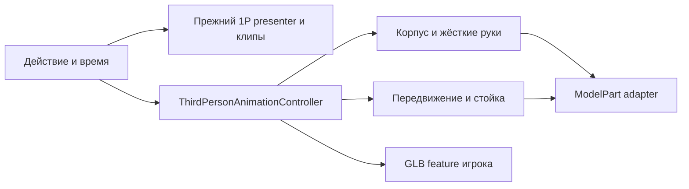

# Этап 5.2 — отдельная презентация игрока от третьего лица

Работа выполнена в существующей ветке `work`, без переключения ветки, reset,
коммита или отправки в GitHub. Исходное рабочее дерево было чистым.
AGENTS.md в `/workspace` не найден. Изучены актуальные классы armament,
архитектура и отчёты этапов 2–5.1, последующие исправления и переход на обычные
руки Minecraft. Исторические FPS-меши не используются как источник новой системы.

**Результат проверки:** 1126 CPU-тестов проходят; новые Blender/GLB подготовлены.
Полная Fabric-сборка и запуск Minecraft в этой среде заблокированы до компиляции
на получении Fabric Loom 1.7.4. Поэтому применение mixin, GPU-отрисовка и
визуальная приёмка в Minecraft остаются непроверенными. Это исходники для
проверки этапа 5.2, а не утверждение о завершённом игровом тестировании.

## Разделение 1P и 3P

- Все 198 зафиксированных файлов прежней презентации остались побайтно прежними:
  [SHA-256 baseline](task5-2/validation/frozen-first-person.json).
  В список входят FPS production-классы, профили, GLB, Blender-файлы, камера и
  исходные скрипты. `FirstPersonWeaponPresenter`, `FirstPersonDiagnostic`,
  `FirstPersonGlbRenderer`, `GltfAnimationController` не редактировались.
- Новые ключевые позы находятся в `scripts/armament/third_person_poses.py`.
  Он не импортирует FPS-клипы, camera-space данные или FPS armature.
  Общая геометрия технического калибра берётся из `create_gauge`; размеры
  предмета сохраняются. Это повторное использование предмета, не анимаций.
- Отдельные `third_person_fixture{,_slim}.blend` и `.glb`: пять действий плюс
  `run` и `crouch`. Runtime GLB содержит только семь полигональных деталей
  предмета и служебные узлы; мешей игрока, рук и skins в нём нет.
- `ThirdPersonAnimationController` имеет свои экземпляры, позы и переходы:
  маска `tp_body` управляет корпусом, позами обеих рук и предметом;
  `tp_motion` — независимый аддитивный слой движения/бега;
  `tp_stance` — отдельный слой приседания. Ноги и голова сохраняют vanilla-анимации.
- `PresentationAction` переносит только ID действия, время начала и флаг
  калибровки. У 1P и 3P согласованы длительности: idle 4 с, inspect 2.75 с,
  raise 0.625 с, lower 0.5 с, move 1 с. Костные трансформации не передаются.
  В 3P inspect предмет заметно поворачивается перед грудью, независимо от FPS.

### Мост жизненного цикла

Новый `PairedPresentationLifecycleMixin` включается только при `/bobin_glb tp show`.
Исходная FPS-диагностика уничтожала presenter при уходе из первого лица.
В парном режиме мост оставляет её семантическую симуляцию активной при F5;
выбор камеры по-прежнему определяет, какой проход рисуется. Это необходимое
расширение жизненного цикла для сохранения действия, а не замена FPS-поз или
камеры. Без запроса TP прежняя политика не меняется. Все проверки владельца
камеры, предметов, травм, транспорта и действий сохраняются.

`FirstPersonSemanticStateAccess` читает только состояние action state machine;
он не предоставляет матрицы, FPS-профиль или pose. Команды `tp anim` вызывают
существующий семантический вход FPS и передают снимок отдельному контроллеру 3P.
`fp anim` также отражается в активной 3P-презентации. `tp show` включает парную
диагностику, не сбрасывая уже активное действие. `tp hide` скрывает только 3P;
`fp hide` делает общий диагностический источник действий неактивным до нового show.

## Руки, привязки и рендер

`ThirdPersonWeaponPresenter` работает в координатах модели игрока, не камеры.
У каждой руки только одна жёсткая трансформация. Длина штатного кубоида —
12 пикселей, ширина Steve/Alex — 4/3, глубина — 4. Реальные плечевые pivot и
центр дистального прямоугольника учтены отдельно для двух моделей.

Blender формирует двухручный хват с фиксированными плечами. После crossfade
адаптер корректирует положение предмета и поворот цельных рук по тем же
3P sockets. Это ограничение жёстких деталей, без локтевых суставов,
масштабирования конечностей или новых кистей. Проверяются как attachment
ошибки, так и близость настоящей геометрии рукоятки/передней опоры к кубоидам.
Блочный хват допускает охват предмета объёмом штатной руки; тест не выдаёт
совпадение пустых маркеров за анатомическую симуляцию пальцев.

Поворот тела и позицию в мире предоставляет стандартный entity renderer.
Ограниченный player-relative look влияет на верх тела, но inspect/lower не
приклеены к движениям головы. Масштаб entity renderer измеряется по его базису:
GLB сохраняет физические метры, а руки — штатные размеры игрока, в том числе
при стандартном player scale 0.9375. Это не подгоночный коэффициент для модели.

Новый render mixin применяется после vanilla `setAngles` и существующих
injury/grenade/GROM-7 hooks. Изменяются только body/rightArm/leftArm и копии
поз jacket/sleeves. После прохода рендера исходные трансформации восстанавливаются.
Скин, UV, видимость рукавов и кубоиды остаются собственностью Minecraft.
Отдельный `ThirdPersonWeaponFeature` рисует предмет через прежний GLB backend.
Обычный `HeldItemFeatureRenderer` не отменяется: диагностика требует пустых рук.

Диагностика отключает позу при травмах/ампутациях, ползании, плавании/полёте,
сне, смерти, невидимости, spectator, использовании предмета, swing, езде,
гранатах, GROM-7, дроне или владении камерой/руками техникой.
Она принимает только локального игрока. Карта сессий и контроллеры привязаны
к UUID; мир/соединение очищают их. Успешный F3+T заменяет GPU bundles атомарно,
контроллер 3P присоединяется к текущему семантическому состоянию. Прежний FPS
при замене своего bundle может перейти в статическую калибровку; это поведение
не менялось ради 3P. При ошибке загрузки
сохраняется последняя корректная генерация.

## Проверки и границы доказательств

- Java 17, Gradle 8.8, CPU-target: **1126 tests, 0 failures/errors/skipped**,
  включая прежние 1072 и 54 новых случая. XML и лог — в
  [task5-2/validation](task5-2/validation/).
- Независимые Blender subframe goldens для Steve/Alex: 4 действия × 9 времён
  × 2 модели. Сравниваются корпус, предмет, руки и sockets.
- Все пять состояний × Steve/Alex × crouch/run: жёсткость матриц, длины и
  плечи, два контакта, Z-Y-X преобразование в ModelPart. Все пары переходов
  и их прерывания; сохранение фазы при пересоздании контроллера; 30/60/144 FPS.
- Triangle-vs-box SAT проверяет отсутствие пересечения GLB с торсом в
  выбранных временных срезах всех состояний. Это CPU-геометрия, не игровой
  тест коллизий и не гарантия для всех сторонних модификаций модели.
- F5: проверены семантическое время, отсутствие зависимости CPU-контроллера
  от перспективы и сохранение действия по общей временной шкале.
  Фактическое срабатывание Minecraft mixin и отсутствие двойного GPU-объекта
  требуют игрового запуска.
- Khronos glTF Validator: **0 errors, 0 warnings** у каждого нового GLB;
  11 infos сохранены в отчётах. Python: 6 геометрических тестов,
  83 общих structural cases, 30 FPS cases и appearance cases проходят.
- Сигнатуры сверены с Yarn ветки 1.20.1, commit
  `9672e1ffb4f7c7059e7a0715a971729c54dfb7d2`, и исходником callback
  Fabric API `0.92.2+1.20.1`. Это статическая сверка, не компиляция Fabric-кода.
- Полная `./gradlew build`: **BLOCKED**, exit 1 при разрешении Fabric Loom;
  прямой запрос к `maven.fabricmc.net` получает proxy HTTP 403.
  Minecraft, F3+T, F5, live skins, освещение, прочие игровые системы и
  графическая производительность **не проверены в игре**.

Все PNG в `art/armament/third_person_fixture*` — **Blender-превью**, не
скриншоты Minecraft. Игровые критерии приёмки вынесены в
[инструкцию](task5-2/IN_GAME_TEST_RU.md).

## Источник идей и дальнейшая граница

Прочитан [MCModderAnchor/TACZ](https://github.com/MCModderAnchor/TACZ), ветка
`1.20.1`, commit `2d304e39a3ad774095f72b6932308fba99d09e4f`, в частности
`InnerThirdPersonManager` и `PlayerModelMixin`. Использованы идеи отдельной
3P-презентации и адаптации штатных частей модели. Forge API, код GPL,
модели, текстуры и ключевые позы TACZ не переносились. Реализация — Fabric/Yarn.

Сетевая синхронизация только спроектирована:
`owner UUID + instance ID + monotonic action sequence + action ID + start tick`.
Авторитетный источник задаёт действия; получатель вычисляет elapsed и
запускает собственный 3P-клип. Snapshot для позднего наблюдателя содержит
текущее действие и начало; старые sequence отбрасываются. Сброс — по instance,
смерти/отключению/смене мира. Костные матрицы и покадровые позы не передаются.
В этом этапе пакеты, remote-player управление, NPC, AI и полноценное оружие
**не реализовывались**. CPU-контроллер не зависит от Minecraft и пригоден
для будущего адаптера сущности после отдельного разрешения.
